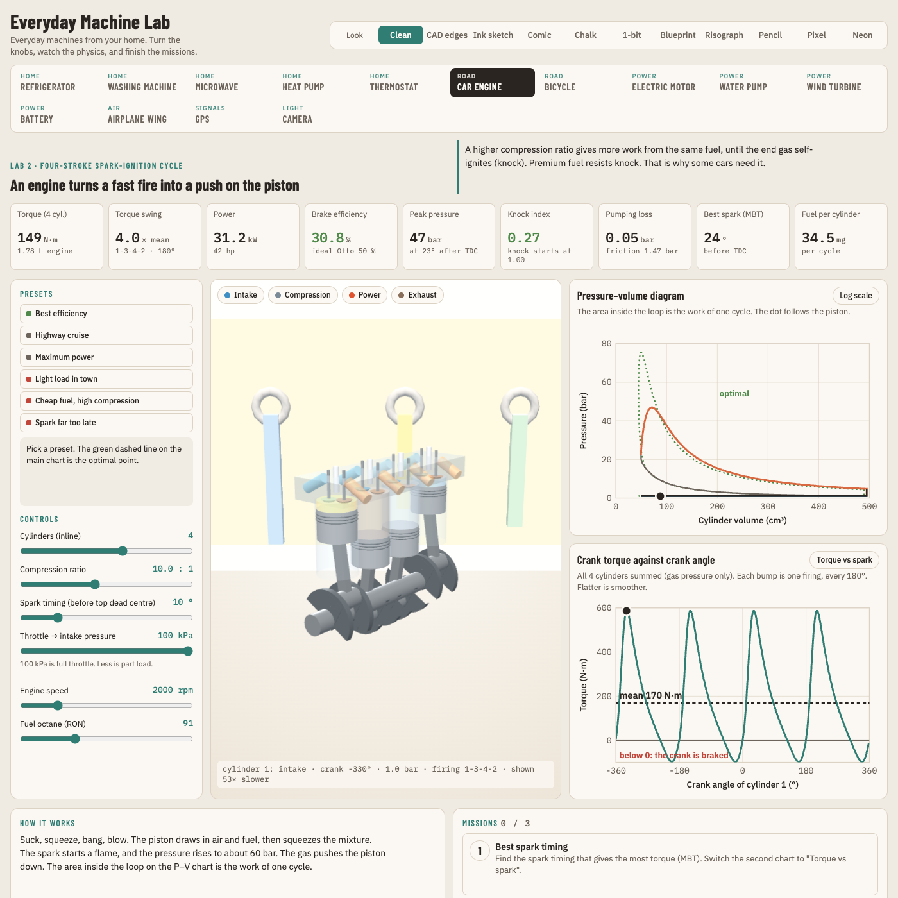

# Everyday Machine Lab

How do everyday machines actually work? Pick one, turn its knobs and watch the physics respond. Each lab has a 3D model, live charts, presets and three missions.

| Group | Lab | What it teaches |
|---|---|---|
| Home | Refrigerator | Vapour-compression cycle: a fridge moves heat uphill by boiling a liquid (R-600a, P–h diagram) |
| Home | Washing machine | Forced vibration: an unbalanced spin-up passes through resonance and shakes the floor |
| Home | Microwave | Standing waves: the oven heats in hot and cold spots |
| Home | Heat pump | 1 kW of electricity can move 3 kW of heat (R-290, COP against outdoor temperature) |
| Home | Thermostat | Feedback control: on/off against PID, overshoot and swing |
| Road | Car engine | Four-stroke spark-ignition cycle: Wiebe burn, knock, P–V loop, 1–6 cylinders with firing orders |
| Road | Bicycle | Gears trade pedal force for speed; air drag takes most of the power |
| Power | Electric motor | Back-EMF, torque and the efficiency map |
| Power | Water pump | Pump curve against system curve; the pipes set the flow |
| Power | Wind turbine | Betz limit and pitch control |
| Power | Battery | Li-ion cell: voltage sag, internal resistance and heat |
| Air | Airplane wing | Lift, drag and stall against angle of attack |
| Signals | GPS | Position from signal timing, satellite geometry and the relativity correction |
| Light | Camera | Lenses, depth of field and exposure |

## How each lab teaches

- **Predict, then try.** Each mission starts with a one-tap prediction. The task appears after you answer, and the result says whether the model agreed.
- **Watch the right numbers.** The readouts that matter for the open mission are outlined, and the mission names them. On a phone, only the key readouts show until you ask for all of them.
- **Myth or fact?** Each lab names one common wrong belief (a fridge makes cold, premium fuel adds power, air over a wing must meet again at the back) and tells you how to disprove it with the sliders.
- **Glossary.** Dotted terms (COP, TDC, HDOP, NPSH, back-EMF and about 70 more) show a short meaning on tap or hover.

There are 11 looks to choose from: **Clean**, **CAD edges**, and nine hand-drawn post-process styles (ink sketch, comic, chalk, 1-bit, blueprint, risograph, pencil, pixel, neon). The page layout stays the same in every look.



## Run it

```sh
cd web && python3 -m http.server 8765     # then open http://localhost:8765
```

There is no build step. The page uses three.js r128 and OrbitControls from a CDN.

## How it is built

- `web/index.html` holds the app shell, the shared helpers, the looks, the background sets and the first three labs (fridge, engine, washer).
- `web/physics.js` holds the pure models for those three labs. `web/r600a.js` holds the R-600a property tables.
- `web/teach.js` holds the teaching content for every lab: predictions, outlined readouts, myths and the glossary. Teachers can edit it without touching the physics.
- `web/labs/<id>.js` holds one plug-in per extra lab. Each one calls `registerLab()`. The contract is in [web/labs/README.md](web/labs/README.md).
- The physics are plain functions, kept apart from the drawing code. Values that come from estimates are marked "est." in each lab's notes.
- Refrigerant properties are precomputed from CoolProp (81 KB) instead of shipping the 6 MB CoolProp WASM: `tools/make_r600a.py` and `tools/make_fluid.py`.
- The 3D models are procedural three.js geometry, so the parts can move.

## Checks

```sh
for t in tools/test_*.js; do node "$t"; done          # physics sanity tests, one suite per lab

cd web && python3 -m http.server 8765 &               # the browser checks need a local server
cd ..
LABS="fridge engine" sh tools/shot.sh shots            # screenshots + console errors + tile values
W=1400 H=1000 LAB=engine sh tools/layout_check.sh       # layout shift between looks (expect WORST 0)
W=500 H=1100 LAB=engine sh tools/overflow_check.sh      # clipped or overflowing text (expect TOTAL 0)
sh tools/look_matrix.sh shots/looks                     # every look x every lab, shader errors + contact sheets
```

The browser checks find Chrome on macOS, Linux or Windows (Git Bash). You can also set `CHROME=/path/to/chrome` and `PORT=...`.

## Docs

- [docs/machine_survey.md](docs/machine_survey.md) and [docs/machine_survey_2.md](docs/machine_survey_2.md): 82 candidate machines, scored on teaching value, first-look appeal, validation data and effort.
- [docs/directions.html](docs/directions.html) and [docs/styles.html](docs/styles.html): the visual direction studies.

## Licence

MIT, see `LICENSE`.
